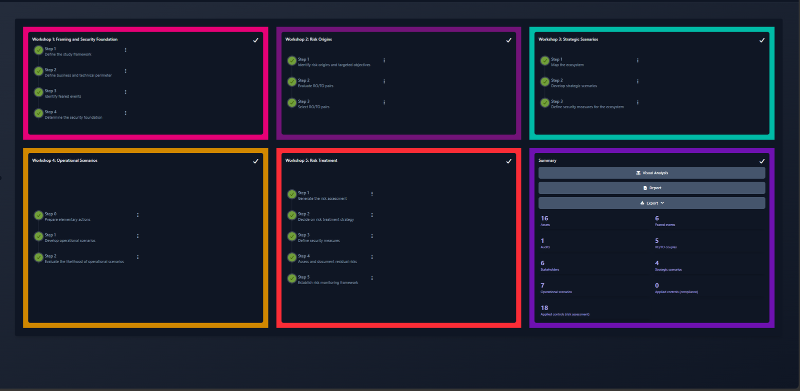
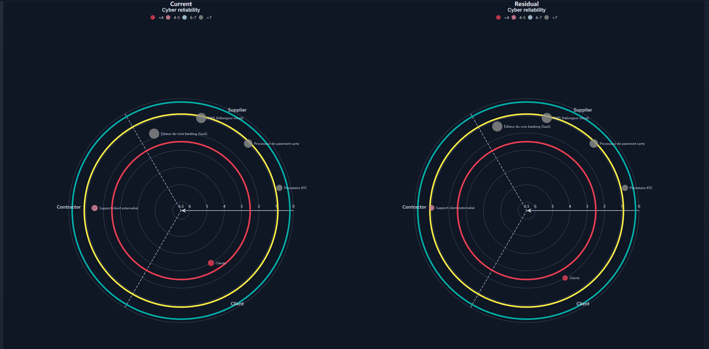
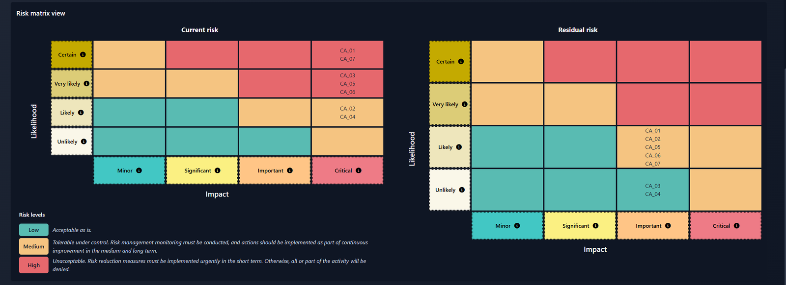
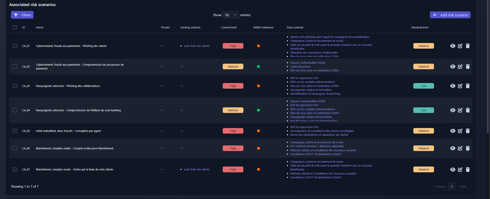
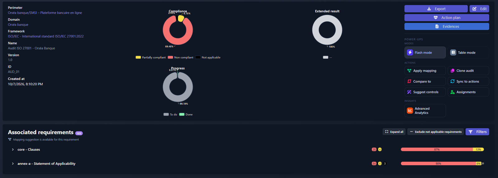
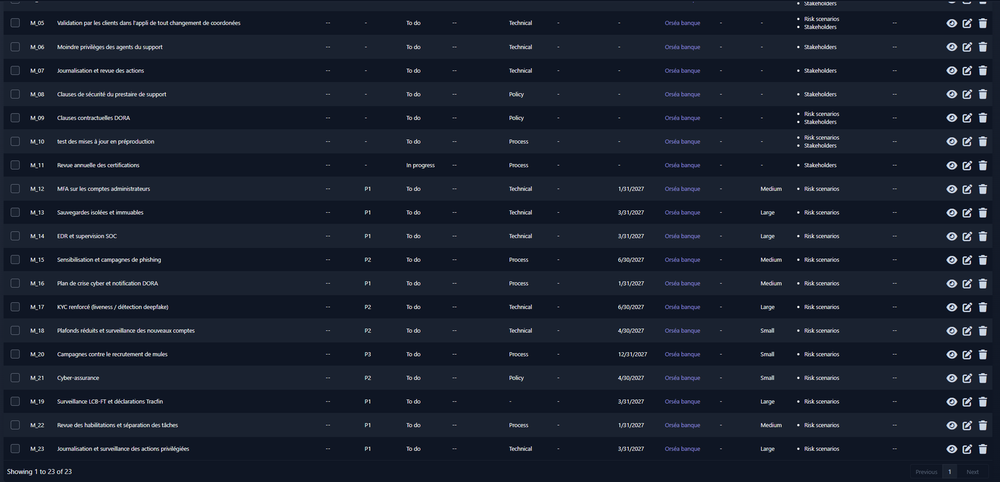

# Orséa Banque : SMSI ISO 27001 et analyse de risques EBIOS RM

Projet GRC mené de A à Z sur une néobanque fictive, Orséa Banque : analyse de risques, traitement, déclaration d'applicabilité ISO 27001, politique de sécurité, présentation au comité exécutif, et l'ensemble des documents du système de management (clauses 4 à 10).

Outil : [CISO Assistant](https://intuitem.com/ciso-assistant/) (édition communautaire, installé en local avec Docker).
Référentiels : ISO/IEC 27001:2022, EBIOS Risk Manager (ANSSI), DORA, RGPD.

## Le contexte

Orséa est une banque en ligne : une appli mobile, une carte, un core banking loué à un éditeur, un hébergement chez AWS et un support client en partie externalisé. Comme toute banque en France, elle doit respecter DORA, le RGPD et les règles anti-blanchiment, sous le contrôle de l'ACPR.

## L'analyse de risques (EBIOS RM)

J'ai suivi les cinq ateliers de la méthode :

- 6 valeurs métier et leurs besoins de sécurité (disponibilité, intégrité, confidentialité, preuve)
- les attaquants plausibles et leurs objectifs : cybercriminels, groupes de rançongiciel, agent interne corrompu, réseaux de blanchiment
- 6 parties prenantes notées selon le niveau de menace qu'elles représentent
- 7 scénarios d'attaque détaillés étape par étape (28 actions au total)
- une stratégie de traitement pour chaque risque

## Les résultats

Les 7 risques avaient tous la gravité maximale et cinq étaient à un niveau élevé. Après le plan de traitement, il n'en reste aucun.

| Risque | Scénario | Avant | Stratégie | Après |
|---|---|---|---|---|
| CA_01 | Fraude aux paiements par phishing des clients | Élevé | Réduire | Moyen |
| CA_02 | Piratage du processeur de paiement | Moyen | Transférer | Moyen |
| CA_03 | Rançongiciel via un collaborateur piégé | Élevé | Réduire | Faible |
| CA_04 | Rançongiciel via l'éditeur du core banking | Moyen | Réduire | Faible |
| CA_05 | Agent du support corrompu | Élevé | Réduire | Moyen |
| CA_06 | Comptes ouverts pour blanchir de l'argent | Élevé | Réduire | Moyen |
| CA_07 | Clients recrutés comme mules | Élevé | Réduire | Moyen |

## Le passage à ISO 27001

J'ai évalué les 93 contrôles de l'Annexe A d'ISO 27001:2022 dans une déclaration d'applicabilité. Trois sont exclus (7.8, 7.11, 7.12) parce qu'Orséa n'a pas de salle serveur : la sécurité physique de l'hébergement relève d'AWS et est encadrée par le contrôle 5.23. Sur les 90 restants, 84 ne sont pas encore en place. C'est normal au démarrage : c'est le point de départ du plan.

## Le plan et la direction

23 mesures, chacune avec un responsable, une priorité, une échéance et un coût estimé (environ 805 k€ la première année, chiffre fictif). Ensuite, une politique de sécurité (PSSI) en 15 sections et une présentation de 8 slides pour le comité exécutif, qui se termine sur les quatre décisions demandées.

## Le système de management (clauses 4 à 10)

Une analyse de risques et une SoA ne suffisent pas à faire un SMSI : la norme exige aussi tout le système de management autour. Chaque clause a son document dans le dossier [smsi/](smsi/).

| Clause | Exigence | Document |
|---|---|---|
| 4.1, 4.2 | Enjeux, parties intéressées | [01-contexte.md](smsi/01-contexte.md) |
| 4.3, 4.4 | Domaine d'application, système de management | [01-contexte.md](smsi/01-contexte.md) |
| 5.1, 5.3 | Engagement de la direction, rôles (RACI) | [02-leadership.md](smsi/02-leadership.md) |
| 5.2 | Politique | [PSSI](livrables/PSSI_Orsea_Banque.pdf) |
| 6.1.2, 8.2 | Appréciation des risques | Analyse EBIOS RM : [ateliers 1 à 4](livrables/) |
| 6.1.3, 8.3 | Traitement des risques, SoA | [atelier 5](livrables/EBIOS_Atelier5_Traitement_des_risques.xlsx), [SoA](livrables/SoA_ISO27001_Orsea_Banque.xlsx), [plan de traitement](livrables/Plan_de_traitement_Orsea_Banque.xlsx) |
| 6.2, 6.3 | Objectifs, planification des changements | [03-objectifs.md](smsi/03-objectifs.md) |
| 7.1 à 7.5 | Ressources, compétences, sensibilisation, communication, documents | [04-support.md](smsi/04-support.md) |
| 9.1 | Indicateurs | [05-indicateurs.md](smsi/05-indicateurs.md) |
| 9.2 | Audit interne et pré-audit | [06-audit-interne.md](smsi/06-audit-interne.md) |
| 9.3 | Revue de direction | [07-revue-de-direction.md](smsi/07-revue-de-direction.md) |
| 10.1, 10.2 | Amélioration, non-conformités | [08-amelioration.md](smsi/08-amelioration.md) |

Le pré-audit a relevé 6 non-conformités, dont 2 majeures : les risques résiduels n'étaient pas acceptés formellement, et les contrats des prestataires critiques ne contenaient pas les clauses exigées par DORA. Elles sont suivies jusqu'à leur levée dans le registre des actions correctives.

## Ce que je ferais différemment

- Au début, je voulais accepter deux risques élevés liés au blanchiment. Un risque élevé de gravité maximale, on commence par le réduire.
- J'avais mis des mesures pas encore réalisées dans les mesures existantes. Le risque actuel paraissait alors plus faible qu'il ne l'était.
- Pour l'agent corrompu, j'avais pensé au contrôle d'identité à l'ouverture de compte. Contre une menace interne, ce qui marche, c'est la gestion des accès : moindre privilège, revue des droits, validation à deux personnes.

## Livrables

| Document | Fichier |
|---|---|
| Présentation au comité exécutif | [Synthese_COMEX_Orsea_Banque.pdf](livrables/Synthese_COMEX_Orsea_Banque.pdf) |
| Politique de sécurité (PSSI) | [PSSI_Orsea_Banque.pdf](livrables/PSSI_Orsea_Banque.pdf) |
| Déclaration d'applicabilité ISO 27001 | [SoA_ISO27001_Orsea_Banque.xlsx](livrables/SoA_ISO27001_Orsea_Banque.xlsx) |
| Plan de traitement | [Plan_de_traitement_Orsea_Banque.xlsx](livrables/Plan_de_traitement_Orsea_Banque.xlsx) |
| Atelier 1 : besoins de sécurité (DICP) | [DICP_Orsea_Banque.xlsx](livrables/DICP_Orsea_Banque.xlsx) |
| Atelier 1 : événements redoutés | [EBIOS_Atelier1_Evenements_redoutes.xlsx](livrables/EBIOS_Atelier1_Evenements_redoutes.xlsx) |
| Atelier 2 : sources de risque | [EBIOS_Atelier2_SR_OV.xlsx](livrables/EBIOS_Atelier2_SR_OV.xlsx) |
| Atelier 3 : écosystème | [EBIOS_Atelier3_Ecosysteme.xlsx](livrables/EBIOS_Atelier3_Ecosysteme.xlsx) |
| Atelier 4 : scénarios opérationnels et actions élémentaires | [EBIOS_Atelier4_Scenarios_operationnels.xlsx](livrables/EBIOS_Atelier4_Scenarios_operationnels.xlsx) |
| Atelier 5 : traitement des risques et risque résiduel | [EBIOS_Atelier5_Traitement_des_risques.xlsx](livrables/EBIOS_Atelier5_Traitement_des_risques.xlsx) |

---

Orséa Banque est une entreprise fictive : les prestataires, les chiffres et les budgets sont inventés pour l'exercice.
